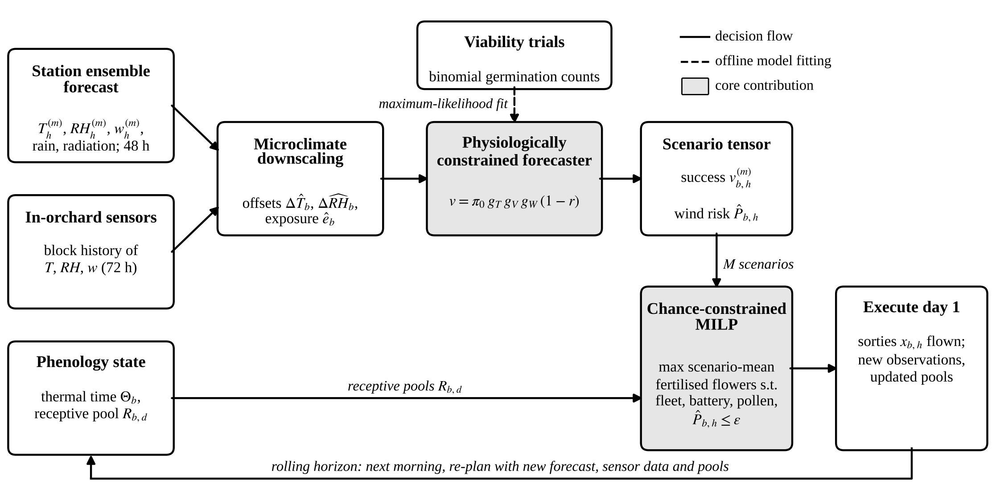

# CLIMA-POLL: Pollination-Success Forecasting and Chance-Constrained Drone Scheduling

Code for the manuscript **"Physiologically Constrained Pollination-Success Forecasting and Scenario-Based Chance-Constrained Drone Scheduling under Climate Variability"** (Paper 2 of the autonomous drone pollination series).



## What the code does

Pollen germinates and reaches the ovule only within a narrow band of temperature, humidity, wind and rain. CLIMA-POLL forecasts pollination success for every orchard block and hour, then schedules a drone fleet into the best hours while limiting the risk of flying in unsafe wind.

- **Physiological forecaster (PCF):** a cardinal-temperature beta response (Yan–Hunt), a VPD desiccation term (Tetens), wind deposition and a rain mask. Its 8 parameters are fitted by binomial maximum likelihood to germination trials.
- **Ensemble downscaling:** a 16-member station ensemble is mapped to 8 blocks, with sensor-learned offsets.
- **Scenario chance-constrained MILP:** solved with HiGHS via `scipy.optimize.milp`. Tangent cuts handle the concave fertilisation response. A per-slot wind constraint requires that at most a share ε = 0.10 of ensemble members exceed the wind limit. Plans use a 48 h rolling horizon and execute the first day.
- **Baselines:** fixed calendar, weather-threshold rule, mean-forecast MILP (with and without a wind margin), a hybrid program and a perfect-information oracle.

## Files

| File | Purpose |
|---|---|
| `climapoll.py` | Weather/orchard simulator, forecasters, schedulers and the main experiment (5 replicates × 6 seasons) |
| `frontier.py` | Risk–return frontier (wind margin vs. ε for the scenario and hybrid programs) |
| `extra.py` | Pollen-budget and component studies |
| `windcal.py` | Reliability of the wind chance constraint |
| `ts.py` | Heatwave time-series example |
| `ensize.py`, `ensize_an.py` | Ensemble-size study (M = 4…64) and its figure |
| `analyze.py` | Aggregation, paired tests, all tables and figures, `numbers.json` |
| `fig_arch.py` | Architecture diagram |
| `CLIMAPOLL_colab.ipynb` | The same pipeline as a single Colab notebook |
| `reference_numbers.json` | Every number reported in the paper, from the original full run |
| `run_all.sh` | Runs the full pipeline in order |

## How to run

```bash
pip install -r requirements.txt
bash run_all.sh              # full run (about 2–3 h on a CPU)
FAST=1 bash run_all.sh       # quick smoke test
```

On Google Colab, open `CLIMAPOLL_colab.ipynb` and choose *Runtime → Run all*. Only preinstalled packages are used, and a CPU runtime is enough.

## Main results (5 replicates × 6 seasons)

| Policy | Fruit set | Sorties above wind limit |
|---|---|---|
| Fixed calendar | 51.3 % | – |
| Weather-threshold rule | 55.2 % | – |
| Mean-forecast MILP | 64.6 % | 3.82 % |
| **Scenario chance-constrained MILP (proposed)** | **63.1 %** | **0.97 %** |
| Perfect-information oracle | 66.2 % | – |

On out-of-range heatwave and cold hours, the physiological forecaster makes much smaller errors than gradient boosting. A tuned wind margin of 1.0 m/s performs about as well as ε = 0.10, and the paper reports this. Unsafe sorties fall from 1.9 % to 0.6 % as the ensemble grows from 4 to 64 members.

## Note on data

All weather, orchard and germination data are simulated from fixed seeds. Absolute values depend on the simulator; comparisons between policies are paired on identical seasons.

## License

MIT (see `LICENSE`). If you use this code, please cite the paper once it is published.
